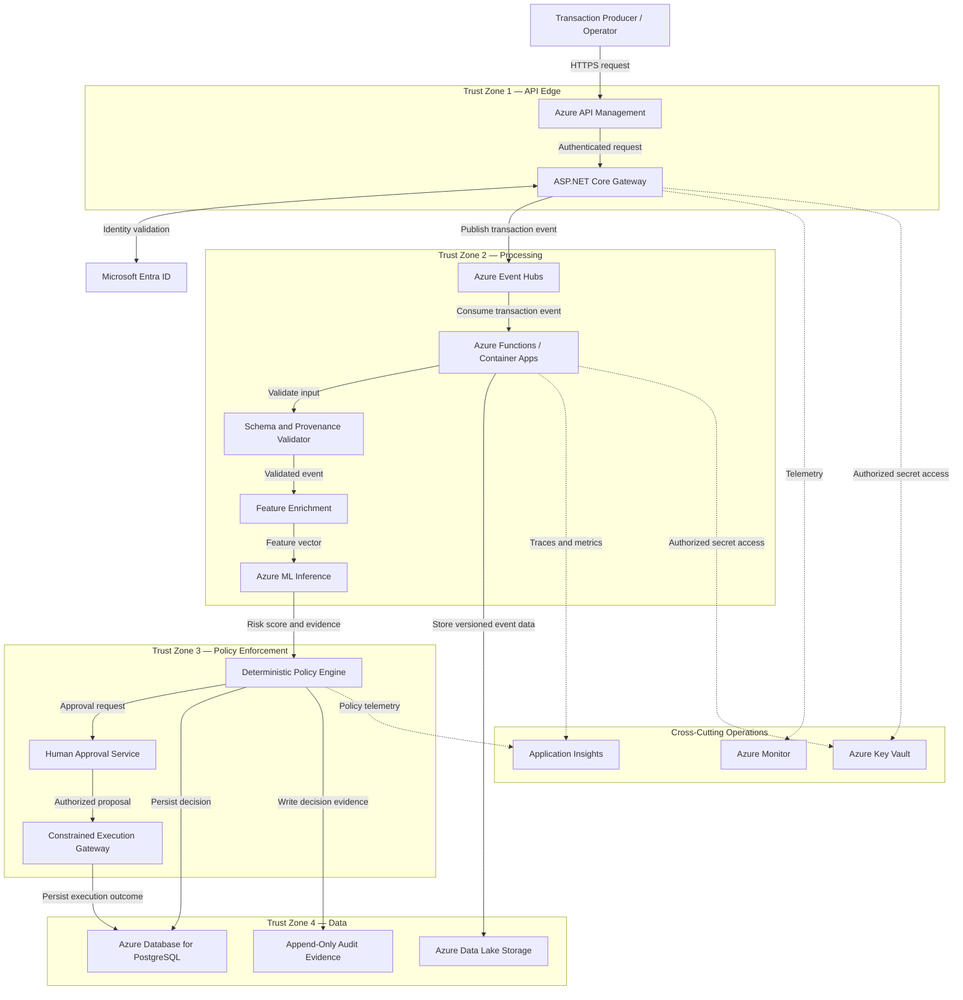

# FraudShield AI — C4 Level 2: Container Architecture

## 1. Purpose

This document defines the container-level architecture
of the FraudShield AI platform.

It identifies the primary application components,
Azure services, communication paths, trust zones,
data stores, and reliability responsibilities.

The architecture supports real-time fraud detection,
risk decisioning, human approval, and auditable operations.

## 2. Architecture Principles

FraudShield AI follows these architectural principles:

1. Event-driven processing
2. Separation of responsibilities
3. Zero-trust security
4. Least-privilege access
5. Deterministic policy enforcement
6. Tenant isolation
7. Idempotent processing
8. Auditable decisions
9. Safe failure handling
10. Reproducible infrastructure

## 3. Container Architecture Diagram

## 4. Primary Components

| Component               | Responsibility                                                 |
| ----------------------- | -------------------------------------------------------------- |
| Azure API Management    | Authentication edge, quotas, routing, and API protection       |
| ASP.NET Core Gateway    | Request handling, validation, correlation, and authorization   |
| Azure Event Hubs        | Transaction event ingestion and buffering                      |
| Event Processor         | Transaction processing orchestration                           |
| Schema Validator        | Schema, provenance, and data quality validation                |
| Feature Enrichment      | Contextual risk feature generation                             |
| Azure Machine Learning  | Fraud risk inference                                           |
| Policy Engine           | Deterministic fraud decision enforcement                       |
| Approval Service        | Human authorization of consequential actions                   |
| Execution Gateway       | Restricted and auditable privileged operations                 |
| PostgreSQL              | Transaction decisions, workflow state, and idempotency records |
| Azure Data Lake Storage | Versioned datasets, source events, and replay evidence         |
| Audit Evidence Store    | Durable, access-controlled audit records                       |
| Azure Monitor           | Platform monitoring and alerting                               |
| Application Insights    | Distributed tracing and application telemetry                  |
| Azure Key Vault         | Secure storage of required secrets and certificates            |

## 5. API Edge

### 5.1 Azure API Management

Responsibilities:

- Enforce API access policies.
- Apply request quotas and rate limits.
- Route requests to the ASP.NET Core gateway.
- Propagate correlation identifiers.
- Reject malformed or unauthorized requests.

### 5.2 ASP.NET Core Gateway

Responsibilities:

- Validate authenticated caller identity.
- Resolve tenant identity from trusted context.
- Validate request contracts.
- Enforce application authorization.
- Assign or validate correlation identifiers.
- Publish authorized transaction events.
- Return appropriate processing acknowledgements.

The gateway must not trust client-provided tenant
identifiers as authoritative.

## 6. Event Ingestion

### Azure Event Hubs

Azure Event Hubs provides the primary transaction
event ingestion channel.

Responsibilities:

- Accept authorized transaction events.
- Buffer events for asynchronous processing.
- Support consumer groups.
- Enable controlled event replay within configured retention.
- Decouple API traffic from processing workloads.

Event Hubs does not replace the application-level
requirements for idempotency or durable workflow state.

## 7. Event Processing

### Azure Functions / Container Apps

The processing layer orchestrates:

1. Event consumption
2. Schema validation
3. Source provenance verification
4. Event freshness validation
5. Duplicate detection
6. Feature enrichment
7. Fraud risk inference
8. Policy evaluation
9. Decision persistence
10. Decision publishing

### Processing Constraints

- Processing must be tenant-aware.
- Invalid events must not reach inference.
- Duplicate events must not repeat consequential actions.
- Required processing evidence must be preserved.
- Failures must be observable and recoverable.

## 8. Schema and Provenance Validator

Responsibilities:

- Validate event schema versions.
- Reject unknown or invalid fields.
- Verify required identifiers.
- Validate transaction timestamps.
- Validate source provenance.
- Detect malformed transaction values.
- Enforce event freshness rules.

Validation must occur before fraud inference.

## 9. Feature Enrichment

Responsibilities:

- Produce contextual transaction features.
- Retrieve authorized historical information.
- Preserve feature lineage.
- Prevent cross-tenant feature access.
- Record feature schema versions.

Potential features include:

- Transaction amount
- Transaction frequency
- Historical spending patterns
- Merchant risk indicators
- Device change indicators
- Geographic anomalies
- Account activity patterns

Feature definitions and availability will be
implemented in subsequent phases.

## 10. Fraud Risk Inference

### Azure Machine Learning

The inference component generates a fraud risk score.

Expected score range:

0.0 to 1.0

A higher score represents higher estimated fraud risk.

Inference output should contain:

- Risk score
- Model version
- Inference timestamp
- Correlation identifier
- Available explanatory evidence

The inference service must not:

- Approve privileged operations.
- Override authorization.
- Modify risk policies.
- Access unauthorized tenant data.
- Execute arbitrary external commands.

## 11. Deterministic Policy Engine

The policy engine converts risk scores and
validated evidence into fraud decisions.

Initial decision categories:

- APPROVE
- REVIEW
- DECLINE
- ABSTAIN

The engine must evaluate:

- Policy version
- Risk thresholds
- Required evidence
- Input validity
- Authorization status
- Dependency availability
- Applicable approval requirements

Policy decisions must remain independent
of model-generated instructions.

## 12. Human Approval Service

The approval service manages review and authorization
for consequential actions.

Responsibilities:

- Create approval requests.
- Verify reviewer identity.
- Validate reviewer permissions.
- Bind approval to an exact operation.
- Bind approval to an argument hash.
- Track approval status.
- Record approval evidence.
- Enforce approval expiration.

An approval for one operation must not authorize
a different operation.

## 13. Constrained Execution Gateway

The execution gateway is the security boundary
for privileged actions.

Required validation:

1. Actor identity
2. Tenant ownership
3. Resource scope
4. Operation schema
5. Policy authorization
6. Risk classification
7. Human approval, when required
8. Idempotency key
9. Approved destination
10. Postcondition verification

No fraud model may invoke privileged execution directly.

## 14. Persistent Storage

### 14.1 Azure Database for PostgreSQL

Stores:

- Transaction processing records
- Fraud decisions
- Workflow states
- Approval records
- Idempotency records
- Policy references
- Decision metadata

Requirements:

- Tenant-scoped access
- Transactional consistency
- Database migrations
- Controlled retention
- Backup and recovery

### 14.2 Azure Data Lake Storage

Stores:

- Versioned source datasets
- Synthetic transaction datasets
- Evaluation datasets
- Replay inputs
- Data lineage metadata

Requirements:

- Version tracking
- Access control
- Encryption
- Approved retention
- Dataset provenance

### 14.3 Audit Evidence

Audit records must capture:

- Actor
- Tenant
- Operation
- Decision
- Policy version
- Model version
- Correlation identifier
- Timestamp
- Approval reference
- Execution outcome

Audit evidence must be protected against
unauthorized modification.

## 15. Observability

### Azure Monitor

Collects:

- Service availability
- Error rates
- Queue age
- Processing throughput
- Infrastructure health
- Operational alerts

### Application Insights

Collects:

- Request traces
- Processing spans
- Dependency latency
- Inference latency
- Decision latency
- Exception telemetry

### Telemetry Security

Do not log:

- Authentication tokens
- Passwords
- Private keys
- Unnecessary personal information
- Full sensitive transaction payloads

## 16. Reliability Requirements

The platform must:

- Persist processing state before acknowledging messages.
- Use idempotent event consumers.
- Support retries with bounded attempts.
- Route unrecoverable events to a dead-letter workflow.
- Preserve event correlation identifiers.
- Record schema, policy, and model versions.
- Support deterministic replay.
- Preserve tenant isolation during recovery.
- Maintain decision auditability.

## 17. Failure Behavior

| Failure                      | Expected Behavior                       |
| ---------------------------- | --------------------------------------- |
| Invalid schema               | Reject and audit                        |
| Unauthenticated request      | Reject                                  |
| Unauthorized request         | Reject                                  |
| Cross-tenant request         | Deny access                             |
| Duplicate event              | Return or reference existing result     |
| Stale event                  | Reject or quarantine                    |
| Inference timeout            | Abstain or apply approved fallback      |
| Policy unavailable           | Fail closed                             |
| Approval denied              | Do not execute                          |
| Database unavailable         | Retry without acknowledging event       |
| Repeated processing failure  | Dead-letter and alert                   |
| External integration failure | Retry safely or report failure          |
| Missing audit persistence    | Do not finalize consequential execution |

## 18. Event Processing Reliability

### Idempotency

Each transaction event must have a stable identifier.

Idempotency checks must be scoped to the verified tenant.

A duplicate event must not cause repeated
consequential side effects.

### Retry Handling

Transient failures may be retried.

Retries must:

- Be bounded.
- Use appropriate backoff.
- Preserve correlation identifiers.
- Avoid duplicate side effects.
- Record retry attempts.

### Dead-Letter Handling

Events that cannot be processed after the
configured retry limit must enter a controlled
dead-letter workflow.

Dead-letter records must include:

- Event reference
- Failure code
- Retry count
- Failure timestamp
- Correlation identifier
- Recovery status

### Replay

Replay must:

- Preserve event identity.
- Preserve original event timestamps.
- Respect tenant authorization.
- Avoid duplicate execution.
- Record replay provenance.

## 19. Deployment Architecture

The platform will use Terraform to provision
Azure infrastructure in P2.

Planned infrastructure:

- Azure API Management
- Azure Event Hubs
- Azure Functions or Container Apps
- Azure Machine Learning
- Azure Data Lake Storage
- Azure Database for PostgreSQL
- Azure Monitor
- Application Insights
- Azure Key Vault
- Managed identities

Infrastructure provisioning must be reproducible.

## 20. Related Documents

- `system-context.md`
- `decision-workflow.md`
- `../security/threat-model.md`
- `../security/risk-policy.md`
- `../quality/non-functional-requirements.md`

## 21. Implementation Status

Phase: P0 — Architecture and Security Baseline

Status: Container architecture specification defined.

The components described here are planned architecture.

They are not yet deployed or operational.
