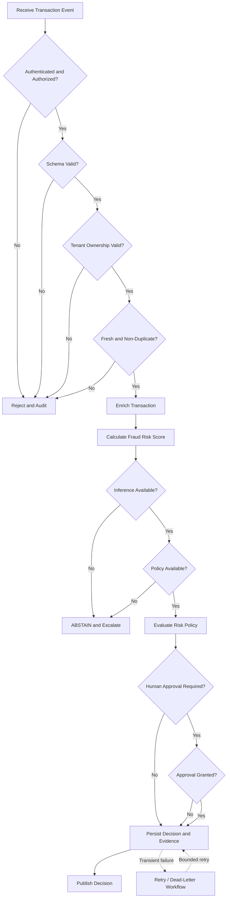

# FraudShield AI — Decision Workflow

## 1. Purpose

This document defines the transaction processing
and fraud decision workflow for FraudShield AI.

The workflow ensures that every transaction is
authenticated, validated, evaluated, and recorded
before a final decision is published.

The workflow also defines failure handling,
human approval, and audit evidence requirements.

## 2. Workflow Objectives

The workflow must:

1. Authenticate the transaction producer.
2. Verify authorization and tenant ownership.
3. Validate the transaction schema.
4. Detect stale and duplicate events.
5. Enrich the transaction with contextual features.
6. Calculate a fraud risk score.
7. Apply deterministic risk policies.
8. Request human approval when required.
9. Persist the decision and supporting evidence.
10. Publish the decision.
11. Support retries, replay, and recovery.

## 3. Decision Workflow Diagram

## 4. Workflow States

The platform uses the following workflow states.

| State             | Description                               |
| ----------------- | ----------------------------------------- |
| RECEIVED          | Transaction event received                |
| VALIDATING        | Schema and authorization checks running   |
| ENRICHING         | Contextual features being generated       |
| SCORING           | Fraud inference running                   |
| EVALUATING_POLICY | Deterministic risk policy being evaluated |
| AWAITING_APPROVAL | Human approval required                   |
| APPROVED          | Required approval granted                 |
| REJECTED          | Request or approval rejected              |
| COMPLETED         | Decision persisted and published          |
| FAILED            | Processing failed                         |
| DEAD_LETTERED     | Event moved to recovery workflow          |

## 5. Transaction Ingestion

The workflow begins when an authenticated producer
submits a transaction event.

Required transaction fields will include:

- Event identifier
- Transaction identifier
- Transaction amount
- Currency
- Transaction timestamp
- Merchant identifier
- Account reference
- Schema version
- Source identifier

Tenant identity must be derived from trusted
authentication context.

A client-supplied tenant identifier must not
override the verified tenant identity.

## 6. Authentication and Authorization

Before processing:

1. Validate the authentication token.
2. Verify the token issuer and audience.
3. Resolve the authenticated actor.
4. Resolve the verified tenant.
5. Check the actor's permissions.
6. Reject unauthorized requests.

Authentication or authorization failures
must not continue to fraud inference.

## 7. Schema Validation

The schema validator must verify:

- Required fields
- Field types
- Identifier formats
- Transaction amount validity
- Timestamp validity
- Supported schema version
- Unknown fields
- Source provenance

Invalid events must be rejected and audited.

## 8. Event Freshness

Transaction events must be checked against
an approved event freshness policy.

The platform must identify:

- Stale events
- Unexpected future timestamps
- Out-of-order events
- Events outside the permitted processing window

The exact freshness window will be defined
in the versioned event policy during implementation.

## 9. Duplicate Detection

Each event must have a stable event identifier.

Duplicate detection must use a tenant-scoped
idempotency key.

When a duplicate is detected:

1. Do not repeat consequential processing.
2. Locate the existing processing record.
3. Return or reference the previous outcome.
4. Record the duplicate delivery when appropriate.

## 10. Feature Enrichment

After validation, the transaction is enriched
with authorized contextual information.

Potential features include:

- Transaction amount
- Recent transaction frequency
- Historical spending behavior
- Merchant risk indicators
- Device activity
- Geographic anomalies
- Account age
- Previous suspicious activity

Feature enrichment must preserve tenant isolation.

## 11. Fraud Risk Scoring

The inference service evaluates the transaction
and returns a fraud risk score.

Valid score range:

0.0 to 1.0

The inference result should include:

- Risk score
- Model version
- Inference timestamp
- Correlation identifier
- Available explanation metadata

The model does not directly authorize
or execute consequential actions.

## 12. Risk Policy Evaluation

The deterministic policy engine evaluates
the fraud risk score and relevant evidence.

Initial provisional thresholds:

| Risk Score            | Decision |
| --------------------- | -------- |
| 0.00 <= score < 0.30  | APPROVE  |
| 0.30 <= score < 0.70  | REVIEW   |
| 0.70 <= score <= 1.00 | DECLINE  |

These thresholds require evaluation and
approval before production use.

### APPROVE

The transaction is classified as acceptable risk.

This classification does not independently
authorize an external financial operation.

### REVIEW

The transaction requires additional investigation
or verification.

### DECLINE

The transaction exceeds the configured
fraud risk threshold.

A DECLINE classification does not independently
authorize an external transaction cancellation.

### ABSTAIN

The platform cannot make a reliable decision.

Possible causes:

- Inference service unavailable
- Required evidence missing
- Policy dependency unavailable
- Invalid inference response
- Unsupported model version

ABSTAIN must be recorded with a reason code.

## 13. Human Approval

Consequential actions require explicit
human authorization unless a separately approved
bounded-autonomy policy permits the operation.

### Approval Request

An approval request must include:

- Approval identifier
- Tenant identifier
- Requesting actor
- Target resource
- Proposed operation
- Operation argument hash
- Risk classification
- Policy version
- Creation timestamp
- Expiration timestamp

### Approval Validation

Before accepting an approval:

1. Authenticate the reviewer.
2. Verify reviewer authorization.
3. Verify tenant ownership.
4. Verify the approval has not expired.
5. Verify the exact operation.
6. Verify the argument hash.
7. Verify approval status.
8. Record the approval decision.

### Approval Denied

When approval is denied:

- Do not execute the proposed action.
- Persist the denial.
- Record the reviewer and timestamp.
- Publish the appropriate workflow outcome.

## 14. Decision Persistence

Every decision must be persisted before
the workflow is considered complete.

Decision records must include:

- Decision identifier
- Event identifier
- Transaction identifier
- Tenant identifier
- Correlation identifier
- Event schema version
- Model or rules version
- Policy bundle version
- Risk score, when available
- Decision category
- Decision reason codes
- Processing timestamp
- Approval reference, when applicable
- Execution result, when applicable

## 15. Decision Publishing

After successful persistence, the platform
publishes the decision to authorized consumers.

Publishing must:

- Preserve the correlation identifier.
- Preserve the decision identifier.
- Preserve the policy version.
- Avoid exposing unauthorized tenant data.
- Support retry without duplicate side effects.

The implementation should use a transactional
outbox to coordinate persistence and publishing.

## 16. Failure Handling

### Authentication Failure

Action:

- Reject the request.
- Record a security event.
- Do not continue processing.

### Schema Validation Failure

Action:

- Reject the event.
- Record the validation failure.
- Do not invoke fraud inference.

### Duplicate Event

Action:

- Identify the existing event.
- Return or reference the previous outcome.
- Do not repeat consequential side effects.

### Inference Failure

Action:

- Record the dependency failure.
- Apply only an approved fallback, if available.
- Otherwise return ABSTAIN.
- Trigger monitoring when appropriate.

### Policy Failure

Action:

- Fail closed.
- Do not authorize privileged execution.
- Record the failure.
- Escalate when necessary.

### Approval Failure

Action:

- Do not execute.
- Persist the failure or denial.
- Record the approval outcome.

### Database Failure

Action:

- Do not acknowledge successful processing.
- Retry safely.
- Preserve idempotency.
- Escalate repeated failures.

### Retry Exhaustion

Action:

- Move the event to the dead-letter workflow.
- Preserve failure evidence.
- Alert operators.
- Support controlled recovery.

## 17. Retry Policy

Transient failures may be retried.

Retries must:

- Use bounded attempts.
- Apply backoff.
- Preserve event identity.
- Preserve correlation identifiers.
- Prevent duplicate side effects.
- Record retry attempts.

Retry limits will be defined in
versioned application configuration.

## 18. Dead-Letter Workflow

Events that cannot be processed safely
must enter a controlled dead-letter workflow.

Required information:

- Event identifier
- Tenant identifier
- Correlation identifier
- Failure code
- Failure timestamp
- Retry count
- Schema version
- Recovery status

Dead-letter events must not be replayed
without appropriate authorization and validation.

## 19. Replay and Recovery

Replay must preserve:

- Original event identity
- Original event timestamp
- Tenant ownership
- Source provenance
- Schema version
- Idempotency guarantees
- Audit evidence

Recovery must not cause duplicate
consequential operations.

## 20. Decision Evidence

Each decision must retain:

- Event identifier
- Tenant identifier
- Correlation identifier
- Event schema version
- Model or rules version
- Policy bundle version
- Risk score
- Decision
- Decision reasons
- Processing timestamp
- Approval reference, when applicable
- Execution result, when applicable

Evidence must support:

- Fraud investigation
- Compliance review
- Operational troubleshooting
- Model evaluation
- Policy evaluation
- Incident investigation

## 21. Security Requirements

The workflow must enforce:

1. Authentication before processing.
2. Authorization before accessing tenant data.
3. Server-side tenant resolution.
4. Schema validation before inference.
5. Idempotent event processing.
6. Deterministic policy enforcement.
7. Human approval for consequential actions.
8. Restricted privileged execution.
9. Auditable decision persistence.
10. Safe failure handling.

## 22. Approval Rule

Human approval is required for consequential actions.

A fraud classification alone does not authorize an
external financial action.

Approval must bind to the exact operation,
arguments, actor, resource, and policy version.

The execution gateway must independently
validate approval before performing the action.

## 23. Related Documents

- `system-context.md`
- `container-architecture.md`
- `../security/risk-policy.md`
- `../security/threat-model.md`
- `../quality/evaluation-specification.md`

## 24. Implementation Status

Phase: P0 — Architecture and Security Baseline

Status: Workflow specification defined.

The operational workflow will be implemented
and tested in subsequent development phases.
