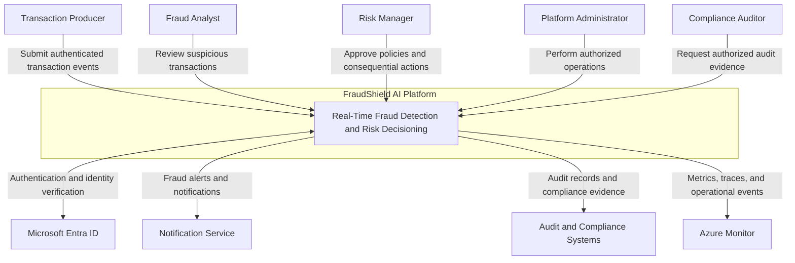

# FraudShield AI — C4 Level 1: System Context

## 1. Purpose

FraudShield AI is a real-time fraud detection and risk decisioning
platform built on Microsoft Azure.

The platform ingests transaction events, validates their integrity,
enriches them with contextual features, calculates fraud risk scores,
applies deterministic risk policies, and publishes auditable decisions.

This document defines the system context, external actors,
integrations, trust boundaries, and security invariants.

## 2. System Overview

FraudShield AI supports the following capabilities:

- Authenticated transaction ingestion
- Transaction schema validation
- Tenant ownership verification
- Event deduplication and freshness checks
- Fraud risk scoring
- Deterministic risk policy evaluation
- Human review and approval
- Auditable decision publishing
- Operational monitoring and alerting
- Event replay and recovery

## 3. External Actors

| Actor                  | Responsibility                                               |
| ---------------------- | ------------------------------------------------------------ |
| Transaction Producer   | Submits transaction events for risk evaluation               |
| Fraud Analyst          | Reviews suspicious transactions and decision evidence        |
| Risk Manager           | Reviews and approves risk policies and consequential actions |
| Platform Administrator | Operates and maintains authorized platform functions         |
| Compliance Auditor     | Reviews decision history and audit evidence                  |

## 4. External Systems

| System                       | Responsibility                                      |
| ---------------------------- | --------------------------------------------------- |
| Microsoft Entra ID           | Authentication and identity management              |
| Transaction Source Systems   | Provide authorized transaction events               |
| Notification Service         | Delivers fraud alerts and review notifications      |
| Audit and Compliance Systems | Consume authorized audit evidence                   |
| Azure Monitor                | Collects platform metrics and operational telemetry |

## 5. System Context Diagram

## 6. Trust Boundaries

### TB-01: External Producer Boundary

All transaction events are untrusted until authenticated,
authorized, and validated.

Required controls:

- Authenticate the transaction producer.
- Validate the producer's authorization.
- Enforce versioned transaction schemas.
- Reject malformed or unauthorized events.
- Validate source provenance.
- Apply request-size and rate limits.

### TB-02: User Identity Boundary

Users authenticate through Microsoft Entra ID.

Actor and tenant identity must be derived from verified
authentication context.

Required controls:

- Validate authentication tokens.
- Verify token issuer and audience.
- Enforce token expiration.
- Apply role-based access control.
- Resolve actor identity server-side.
- Resolve tenant identity from trusted claims or mappings.
- Reject attempts to override tenant identity.

### TB-03: Processing Boundary

Fraud scoring components cannot bypass deterministic
authorization and policy enforcement.

Required controls:

- Treat model outputs as untrusted recommendations.
- Validate risk score ranges.
- Apply deterministic decision policies.
- Preserve model and policy version information.
- Reject invalid inference responses.
- Prevent scoring services from executing privileged actions.

### TB-04: Privileged Execution Boundary

Consequential actions require server-side authorization,
policy validation, and, where required, human approval.

Required controls:

- Validate the requested operation.
- Verify actor authorization.
- Verify resource ownership.
- Validate the applicable risk policy.
- Require human approval for consequential actions.
- Bind approval to the exact operation and arguments.
- Enforce idempotent execution.
- Record execution evidence.

### TB-05: Data Boundary

Tenant data must be logically isolated and access-controlled.

Required controls:

- Apply tenant-scoped database queries.
- Restrict access to transaction and decision records.
- Encrypt data at rest and in transit.
- Prevent cross-tenant data access.
- Minimize sensitive information in logs.
- Maintain auditable data access records.
- Apply approved data retention policies.

### TB-06: External Integration Boundary

Outbound integrations must use approved destinations
and constrained credentials.

Required controls:

- Allow-list approved external destinations.
- Use managed identities where supported.
- Store necessary secrets in Azure Key Vault.
- Restrict outbound network access.
- Validate external integration responses.
- Apply connection and request timeouts.
- Prevent arbitrary model-generated URLs from being executed.

## 7. Security Invariants

The following security invariants must hold throughout
the FraudShield AI platform.

1. No unauthenticated transaction processing.
2. No client-controlled tenant identity.
3. No cross-tenant data access.
4. No model-generated privileged execution.
5. No consequential action without authorization.
6. No transaction decision without auditable evidence.
7. No silent bypass when required dependencies fail.

These invariants must be enforced independently of
machine learning predictions.

## 8. Authorization Principles

FraudShield AI follows the principle of least privilege.

Each actor receives only the permissions required
to perform authorized responsibilities.

### Transaction Producer

Permitted:

- Submit authorized transaction events.
- Retrieve permitted processing acknowledgements.

Not permitted:

- Modify risk policies.
- Approve consequential actions.
- Access another tenant's transactions.
- Execute privileged operations.

### Fraud Analyst

Permitted:

- Review authorized transaction decisions.
- Inspect fraud evidence.
- Submit investigation findings.

Not permitted:

- Modify platform infrastructure.
- Bypass risk policies.
- Access unauthorized tenant data.

### Risk Manager

Permitted:

- Review risk policies.
- Approve authorized policy changes.
- Approve consequential actions within assigned scope.

Not permitted:

- Bypass authentication.
- Approve operations outside assigned authority.

### Platform Administrator

Permitted:

- Manage authorized platform operations.
- Monitor platform health.
- Perform approved maintenance.

Not permitted:

- Bypass audit controls.
- Access customer data without authorization.
- Execute unapproved consequential actions.

### Compliance Auditor

Permitted:

- Review authorized audit evidence.
- Inspect decision history within assigned scope.
- Export permitted compliance records.

Not permitted:

- Modify fraud decisions.
- Execute privileged operations.
- Change risk policies.

## 9. Data Flow Summary

### Flow 1: Transaction Ingestion

1. A transaction producer authenticates.
2. The producer submits a transaction event.
3. The API validates identity and authorization.
4. The platform validates the event schema.
5. The platform accepts the event for processing.

### Flow 2: Fraud Evaluation

1. The platform validates transaction ownership.
2. The platform checks event freshness and duplicates.
3. The platform enriches the transaction.
4. The inference service calculates a fraud risk score.
5. The deterministic policy engine evaluates the score.
6. The platform produces a decision with evidence.

### Flow 3: Human Review

1. A transaction requires additional review.
2. The platform creates a reviewable record.
3. An authorized reviewer inspects the evidence.
4. The reviewer records an approval or rejection.
5. The platform validates the reviewer's authorization.
6. The platform records the final outcome.

### Flow 4: Audit and Monitoring

1. The platform records decision evidence.
2. The platform emits operational metrics.
3. Authorized users can inspect decision history.
4. Approved audit integrations receive permitted evidence.

## 10. Failure Handling Principles

FraudShield AI must fail safely when dependencies
or required controls become unavailable.

Examples:

- Authentication failure: reject the request.
- Authorization failure: reject the request.
- Invalid event schema: reject and audit.
- Cross-tenant access attempt: deny access.
- Inference failure: abstain unless an approved fallback exists.
- Policy service failure: fail closed.
- Approval failure: do not execute.
- Storage failure: retry safely without losing event state.

## 11. Architecture Constraints

The implementation must:

- Use explicit trust boundaries.
- Separate ingestion, processing, policy, and execution.
- Preserve tenant identity throughout processing.
- Use deterministic authorization and policy enforcement.
- Maintain auditable decisions.
- Support idempotent event processing.
- Support replay and recovery.
- Avoid direct privileged execution by ML components.

## 12. Related Documents

- `container-architecture.md`
- `decision-workflow.md`
- `../security/threat-model.md`
- `../security/data-classification.md`
- `../security/risk-policy.md`
- `../quality/non-functional-requirements.md`

## 13. Implementation Status

Phase: P0 — Architecture and Security Baseline

Status: Architecture specification defined.

Azure infrastructure deployment begins in a later phase.

Application implementation begins in P1.
